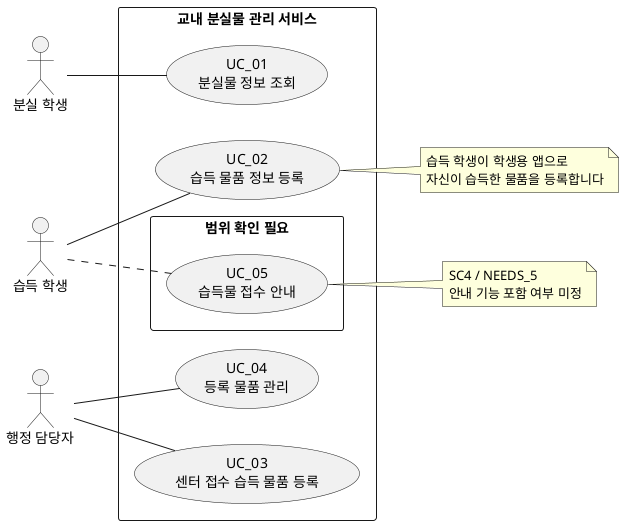

# 유스케이스 명세서 v0.1

## 1. 목적과 범위

유스케이스는 사용자가 달성하려는 하나의 목표를 제공하는 서비스 단위로 식별했다. 검색과 결과 상세 확인처럼 분실물 조회 목표를 달성하기 위한 단계는 하나의 유스케이스로 묶었다. 습득 물품 등록은 습득 학생의 앱 직접 등록과 행정 담당자의 센터 접수 물품 등록, 두 개의 별도 서비스 단위로 식별했다.

## 2. 액터 목록

|액터 ID|액터|구분|시스템을 이용하는 목표|
|---|---|---|---|
|ACT_01|분실 학생|주 액터|잃어버린 물건의 등록·보관 여부, 위치와 담당 부서 문의 방법을 알아보고 행정실 방문을 줄인다.|
|ACT_02|습득 학생|주 액터|학생용 앱에서 자신이 습득한 물품을 직접 등록해 분실자가 찾을 수 있도록 한다.|
|ACT_03|행정 담당자|주 액터|분실물 센터로 접수된 습득 물품을 등록하고, 등록 물품과 보관·인도 상태를 관리해 반복 문의와 관리 부담을 줄인다.|

정보보호 담당자, 학생회, 서비스 운영 책임자는 검토·의견 전달·정책 결정 역할로 기록되어 있으며, 현재 시스템 기능을 직접 수행한다는 요구가 없어 액터에서 제외했다.

## 3. 유스케이스 목록

|유스케이스 ID|유스케이스 (서비스 단위)|주 액터|사용자 목표와 이유|요구사항 근거·상태|
|---|---|---|---|---|
|UC_01|분실물 정보 조회|분실 학생|잃어버린 물건이 등록되었는지 검색하고 보관 여부·공개 위치·문의 방법까지 확인해, 물건을 찾기 위해 어디로 가거나 연락할지 결정한다.|포함. NEEDS_1, NEEDS_4, SC1, SC6, FR_00~FR_02, FR_06~FR_07|
|UC_02|습득 물품 앱 등록|습득 학생|자신이 주운 물건을 학생용 앱에 바로 등록해 분실자가 검색할 수 있도록 한다.|확정. NEEDS_2, SC2, ADD_01, FR_09. 필수 항목과 조회 공개 시점은 미정.|
|UC_03|센터 접수 습득 물품 등록|행정 담당자|분실물 센터로 접수된 습득 물품을 시스템에 등록해 조회·관리할 수 있도록 한다.|확정. NEEDS_2, SC2, ADD_02, FR_03. 필수 입력 항목은 미정.|
|UC_04|등록 물품 관리|행정 담당자|등록된 물품 정보를 확인·수정하고 보관·인도 상태를 관리해 정보가 현재 업무 상태와 맞도록 한다.|포함. NEEDS_2·NEEDS_3, SC2·SC3, FR_04·FR_05·FR_08. 권한 및 정정 절차는 미정.|
|UC_05|습득물 접수 안내|습득 학생|주운 물건을 학교에 전달하기 위해 접수 장소와 방법을 확인한다.|후보·범위 미정. NEEDS_5, SC4, Pol_10. 기존 안내와 프로그램 포함 여부 확인 필요.|

사진으로 유사 물품 검색, 사진 매칭 결과 자동 알림, 개인 휴대전화 번호 공개는 제외 범위이므로 유스케이스에 포함하지 않았다. 실제 물품을 학생에게 전달하는 행위 자체는 시스템 기능으로 요구되지 않았으며, UC_04는 시스템에서 인도 상태를 관리하는 서비스다.

## 4. 유스케이스 다이어그램 (PlantUML)

실선은 확정된 기능, 점선은 고객 확인이 필요한 후보를 나타낸다.

## 5. 고객에게 확인할 질문 사항

|질문 ID|관련 유스케이스|질문|
|---|---|---|
|Q_01|UC_02|습득 학생이 앱에 등록할 때 필요한 필수 정보는 무엇인가?|
|Q_02|UC_02|앱에 등록한 습득 물품은 등록 즉시 분실 학생의 검색 결과에 공개되는가, 아니면 별도 확인 절차 후 공개되는가?|
|Q_03|UC_02, UC_03|학생이 앱으로 등록한 물품과 센터에 접수된 물품이 중복될 경우 어떻게 식별·처리하는가?|
|Q_04|UC_03|센터 접수 물품의 필수 등록 정보는 무엇인가?|
|Q_05|UC_04|행정 담당자는 등록 정보를 어떤 범위까지 수정할 수 있는가? 잘못된 정보·상태를 누가 정정하고 변경 이력을 보존해야 하는가?|
|Q_06|UC_04|‘인도 완료’ 상태 변경을 위해 어떤 확인 절차가 필요하며, 해당 상태를 변경할 권한자는 누구인가?|
|Q_07|UC_01|검색 조건은 무엇이며 학생에게 공개할 물품 정보와 보관 위치의 상세 수준은 어디까지인가?|
|Q_08|UC_01|표시할 담당 부서명과 공식 문의 수단은 무엇인가? 개인 휴대전화 번호는 공개하지 않는 것으로 확정되어 있다.|
|Q_09|UC_05|기존 습득물 접수 장소·방법 안내가 있는가? 이를 서비스 기능에 포함해야 하는가?|
|Q_10|UC_02~UC_04|서비스 운영 책임자는 누구이며 미수령 물품 처리와 기록 보존·삭제 기준은 무엇인가?|

## 6. 요구사항 추적

|고객 요구 ID / 범위|유스케이스|추적 상태|
|---|---|---|
|NEEDS_1, SC1|UC_01|포함|
|NEEDS_2, SC2, ADD_01, ADD_02|UC_02, UC_03, UC_04|학생 앱 직접 등록과 행정 담당자의 센터 접수 물품 등록으로 분리해 반영.|
|NEEDS_3, SC3|UC_04|포함|
|NEEDS_4, SC6|UC_01|포함|
|NEEDS_5, SC4|UC_05|범위 미정|
|NEEDS_6, SC8, C_1|UC_01|개인 번호 비공개 반영. 상세 공개 정보는 결정 필요.|
|NEEDS_7|UC_02, UC_03, UC_04|목표·측정 기준 미정|
